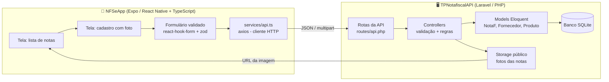
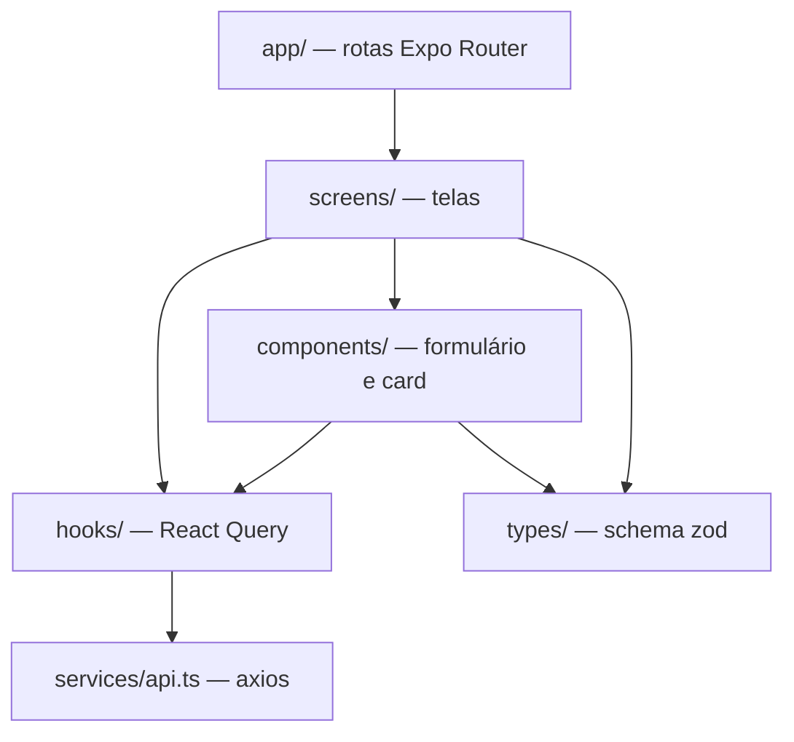
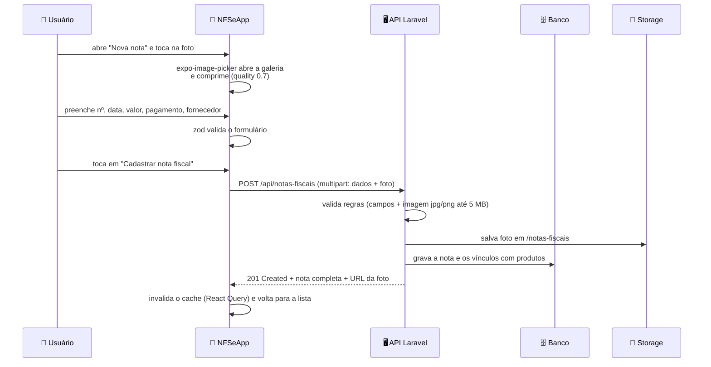
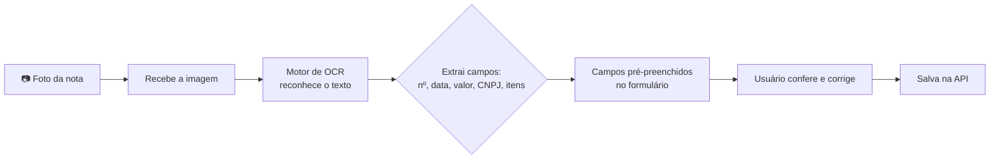

# Apresentação — NFSe Solutions

> Guia de apresentação da estrutura atual do projeto, escrito para quem **não**
> precisa dominar o código. Cada "slide" tem:
>
> - **Título** do slide
> - **O que mostrar** (diagrama ou lista)
> - **O que falar** (texto pronto, em linguagem simples)
> - **Possíveis perguntas** da bancada com respostas prontas
>
> Os diagramas usam sintaxe Mermaid (renderizam no GitHub, no VS Code com
> extensão, ou podem ser colados em [mermaid.live](https://mermaid.live) para
> virar imagem).

---

## Slide 1 — O que é o projeto

**O que falar:**

> "O NFSe Solutions é um aplicativo de celular para **gestão de notas fiscais de
> fornecedores**. Ele foi feito na disciplina de Dispositivos Móveis da FATEC
> Praia Grande e é dividido em duas partes que conversam entre si: um
> **aplicativo** que roda no celular e uma **API** (um servidor de dados) que
> roda no computador."

**Estrutura do repositório:**

```
NFSe-Solutions/
├── TPNotafiscalAPI/   → Backend: servidor de dados (Laravel/PHP)
├── NFSeApp/           → Frontend: aplicativo de celular (Expo/React Native)
└── docs/              → Documentação (apresentação e análise)
```

**Possíveis perguntas:**

- *Por que duas partes?* → Separação de responsabilidades: o celular cuida da
  interface, o servidor cuida dos dados e das regras. É o padrão da indústria.

---

## Slide 2 — Visão geral da arquitetura

**O que mostrar:** diagrama abaixo.



**O que falar:**

> "O fluxo é simples: o usuário preenche o formulário no celular e anexa a foto
> da nota. O aplicativo envia tudo para a API, que **valida os dados**, salva no
> **banco de dados** e guarda a **foto** em armazenamento. Quando o usuário
> abre a lista, a API devolve os dados e a URL da foto para exibir no card."

---

## Slide 3 — Componentes do aplicativo (frontend)

**O que mostrar:** estrutura de pastas + diagrama de dependências.

```
NFSeApp/
├── app/                        → Rotas (Expo Router) — apenas "delegam" para as telas
│   ├── _layout.tsx             → Layout raiz: React Query + cabeçalho
│   ├── index.tsx               → Home
│   └── notas-fiscais/
│       ├── index.tsx           → Lista
│       ├── new.tsx             → Cadastro
│       └── [id]/edit.tsx, [id]/delete.tsx
├── features/notas-fiscais/     → Toda a lógica da funcionalidade
│   ├── types/NotaFiscalSchema.ts   → Contratos de dados (zod)
│   ├── hooks/                      → 6 hooks React Query (cache + chamadas)
│   ├── components/                 → NotaFiscalForm, NotaFiscalCard
│   ├── screens/                    → List, Create, Edit, Delete
│   └── utils/toFormData.ts         → Monta o multipart com a foto
├── services/api.ts             → Cliente axios (baseURL da API)
└── constants/Theme.ts          → Cores, espaçamentos, raios
```



**O que falar:**

> "Seguimos o padrão **feature**: tudo que é da nota fiscal fica dentro de
> `features/notas-fiscais`, dividido em **tipos** (o contrato dos dados),
> **hooks** (a comunicação com a API e o cache), **componentes** (o formulário
> reaproveitado entre criação e edição) e **telas**. As rotas em `app/` são finas
> — só encaminham para a tela certa. Isso deixa o código fácil de localizar e
> avaliar."

**Bibliotecas exigidas pela disciplina (todas em uso):**

| Biblioteca | Onde é usada | Papel |
|---|---|---|
| `react-hook-form` | `NotaFiscalForm.tsx` | gerencia o formulário |
| `zod` + `@hookform/resolvers` | `NotaFiscalSchema.ts` | valida e descreve os dados |
| `axios` | `services/api.ts` | faz as chamadas HTTP |
| `@tanstack/react-query` | `hooks/*.ts` | cache, loading, erro e sincronização |

---

## Slide 4 — Componentes do servidor (backend)

**O que mostrar:** estrutura + tabela de endpoints.

```
TPNotafiscalAPI/
├── routes/api.php                  → 3 recursos REST
├── app/Http/Controllers/
│   ├── NotaFController.php         → CRUD da nota + foto + itens
│   ├── FornecedorController.php    → CRUD de fornecedores
│   └── ProdutoController.php       → CRUD de produtos
├── app/Models/
│   ├── NotaF.php                   → tabela notas_fiscais
│   ├── Fornecedor.php              → tabela fornecedores
│   └── Produto.php                 → tabela produtos
├── database/migrations/            → 8 migrações (estrutura do banco)
├── database/seeders/               → dados de exemplo (3 fornecedores, 5 produtos, 5 notas)
└── storage/app/public/             → fotos enviadas
```

**Endpoints disponíveis:**

| Método | Rota | O que faz |
|---|---|---|
| GET | `/api/notas-fiscais` | lista (paginação de 15 em 15) |
| POST | `/api/notas-fiscais` | cria (aceita foto em multipart) |
| GET | `/api/notas-fiscais/{id}` | detalha uma nota |
| PUT | `/api/notas-fiscais/{id}` | atualiza |
| DELETE | `/api/notas-fiscais/{id}` | exclui (e apaga a foto) |
| GET/POST/PUT/DELETE | `/api/fornecedores` | CRUD de fornecedores |
| GET/POST/PUT/DELETE | `/api/produtos` | CRUD de produtos |

**O que falar:**

> "O backend usa o `apiResource` do Laravel, que gera automaticamente as cinco
> operações REST. O `NotaFController` é o mais completo: ele valida os campos,
> **faz upload da foto** para o armazenamento público, salva a nota e **vincula
> os produtos** na tabela de relação. Ao editar, se chegar foto nova ele apaga a
> antiga; ao excluir, apaga a foto e desvincula os itens."

---

## Slide 5 — Modelo de dados (banco)

**O que mostrar:** diagrama ER.

```mermaid
erDiagram
    FORNECEDORES ||--o{ NOTAS_FISCAIS : "emite"
    NOTAS_FISCAIS ||--o{ NOTA_FISCAL_PRODUTOS : "contém"
    PRODUTOS ||--o{ NOTA_FISCAL_PRODUTOS : "aparece em"

    FORNECEDORES {
        id id PK
        string nome
        string cnpj UK
    }
    NOTAS_FISCAIS {
        id id PK
        fornecedor_id FK
        string numero
        date dt_emissao
        decimal valor_total
        string forma_pagamento
        text observacoes
        string imagem_nf
    }
    PRODUTOS {
        id id PK
        string nome
        decimal preco_venda
    }
    NOTA_FISCAL_PRODUTOS {
        id id PK
        nota_fiscal_id FK
        produto_id FK
        unsignedInteger quantidade
        decimal preco_compra
    }
```

**O que falar:**

> "O modelo tem **quatro tabelas**. Uma nota fiscal pertence a **um fornecedor**
> e pode ter **vários produtos** — por isso existe a tabela intermediária
> `nota_fiscal_produtos`, que guarda a **quantidade** e o **preço de compra**
> daquele item naquela nota (o `preco_venda` fica no produto, é outro
> conceito). Essa é uma relação **N para N** clássica."

---

## Slide 6 — Fluxo prático: da foto ao cadastro

**O que mostrar:** diagrama de sequência.



**Pontos técnicos que valem ser citados:**

- **`toFormData.ts`** monta o `FormData` no formato que o React Native exige
  (`uri/name/type`).
- **Upload em edição:** o PHP não lê arquivo em `PUT`, por isso usamos
  `POST + _method=PUT` (*method spoofing* nativo do Laravel).
- **Cache:** após criar/editar/excluir, o React Query invalida as chaves
  `['notas-fiscais']` para a lista se atualizar sozinha.

---

## Slide 7 — Qualidade e boas práticas aplicadas

**O que falar (lista de pontos para a bancada):**

- **Validação em duas camadas:** `zod` no celular (feedback imediato ao usuário)
  e `$request->validate()` no servidor (regra de verdade). Nenhum dado inválido
  chega ao banco.
- **Contratos tipados:** os schemas Zod espelham exatamente os campos do Model
  Laravel — se a API mudar um nome de campo, o app falha **alto** (erro claro)
  em vez de quebrar em silêncio.
- **Estados de UI completos:** lista trata *loading*, *erro com botão de
  tentar de novo*, *vazio* e *pull-to-refresh*; botões desabilitam durante o
  envio.
- **Delete em tela própria de confirmação**, com modal — não é feito "de
  supetão" na lista.
- **Tema centralizado** (`constants/Theme.ts`): cores, espaçamentos e raios
  iguais em todas as telas.
- **Segurança de ambiente:** `EXPO_PUBLIC_API_URL` vem de `.env` e o README
  explica por que `localhost` não funciona em dispositivo físico.

---

## Slide 8 — O que ainda NÃO está pronto (honestidade técnica)

> Falar isso **antes** de perguntarem mostra domínio do projeto.

1. **Reconhecimento automático (OCR) não implementado.** Hoje a foto é apenas
   **anexada**; os campos são digitados manualmente. O reconhecimento é o
   próximo passo (ver Slide 9).
2. **Captura pela câmera não habilitada** — hoje o app abre só a **galeria**
   de fotos (`launchImageLibraryAsync`). Falta `launchCameraAsync` e a
   permissão de câmera no `app.json`.
3. **Lista limitada a 15 registros** — a API pagina, mas o app busca só a
   primeira página (correção pendente).
4. **URL das fotos pode não abrir em celular** — a API devolve a URL baseada no
   `APP_URL`; em dispositivo físico precisa apontar para o IP da máquina e rodar
   `php artisan storage:link`.
5. **API sem autenticação** — as rotas estão abertas (o Sanctum está instalado,
   mas só a rota `/user` o usa).
6. **Itens da nota** existem no banco e na API, mas o formulário do app ainda
   não envia produtos.
7. **Testes automatizados** apenas os de exemplo do Laravel; nenhum no app.

---

## Slide 9 — Próximos passos: o reconhecimento da nota fiscal

**O que mostrar:** diagrama do fluxo planejado.



**Opções técnicas (escolher uma na apresentação):**

| Opção | Onde roda | Prós | Contras |
|---|---|---|---|
| **A. Google Cloud Vision** | na nuvem, chamado pela API Laravel | ótima precisão, fácil de integrar no backend | precisa chave de API / custo |
| **B. ML Kit (on-device)** | no próprio celular | grátis, offline, privacidade | exige build nativo (dev client) |
| **C. Tesseract** | servidor próprio | 100% gratuito | precisa tratar pré-processamento da imagem |

**Recomendação prática:** começar pela **Opção A** com um endpoint
`POST /api/notas-fiscais/reconhecer` que devolve os campos sugeridos, e o app
apenas **pré-preenche o formulário** — o usuário confirma antes de salvar
(*reconhecimento assistido*, mais seguro do que salvar automático).

---

## Slide 10 — Conclusão

**O que falar:**

> "Hoje o projeto tem um **CRUD completo e funcional** nas duas camadas,
> com validação em dupla, upload de foto, tratamento de estados de interface e
> organização em padrão de mercado. A etapa seguinte é transformar essa foto em
> **informação**, usando OCR para pré-preencher o formulário — que é o
> objetivo final do trabalho."

---

## Perguntas prováveis da bancada (respostas prontas)

| Pergunta | Resposta |
|---|---|
| *Por que usaram Expo e não Android Studio?* | A disciplina é de Dispositivos Móveis e o Expo permite rodar em iOS e Android com um só código, além de facilitar o teste em celular real via QR code. |
| *Por que React Query se o axios já busca os dados?* | O axios transporta; o React Query guarda em cache, evita buscas repetidas, controla *loading/erro* e sincroniza a lista após criar, editar ou excluir. |
| *Onde a foto fica guardada?* | Em `storage/app/public/notas-fiscais/`, servida pela API pela URL `imagem_nf_url`. |
| *Como a validação funciona?* | Duas camadas: `zod` no app (UX) e `$request->validate()` no Laravel (segurança). |
| *Por que tiveram que usar `POST + _method=PUT`?* | Porque o PHP não processa `multipart/form-data` em requisições `PUT`; o Laravel resolve com *method spoofing*. |
| *O app está protegido?* | Não ainda — está no plano de melhorias usar o Sanctum (token) que já está instalado. |
| *O reconhecimento já funciona?* | Ainda não: hoje a foto é anexada e os campos digitados. O OCR é o próximo módulo, com opções já mapeadas (Slide 9). |
| *Dá para rodar o projeto?* | Sim: backend com `composer setup` + `php artisan serve`; app com `npm install` e `npx expo start` apontando `EXPO_PUBLIC_API_URL` para o IP da máquina. |
