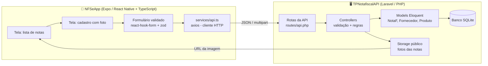
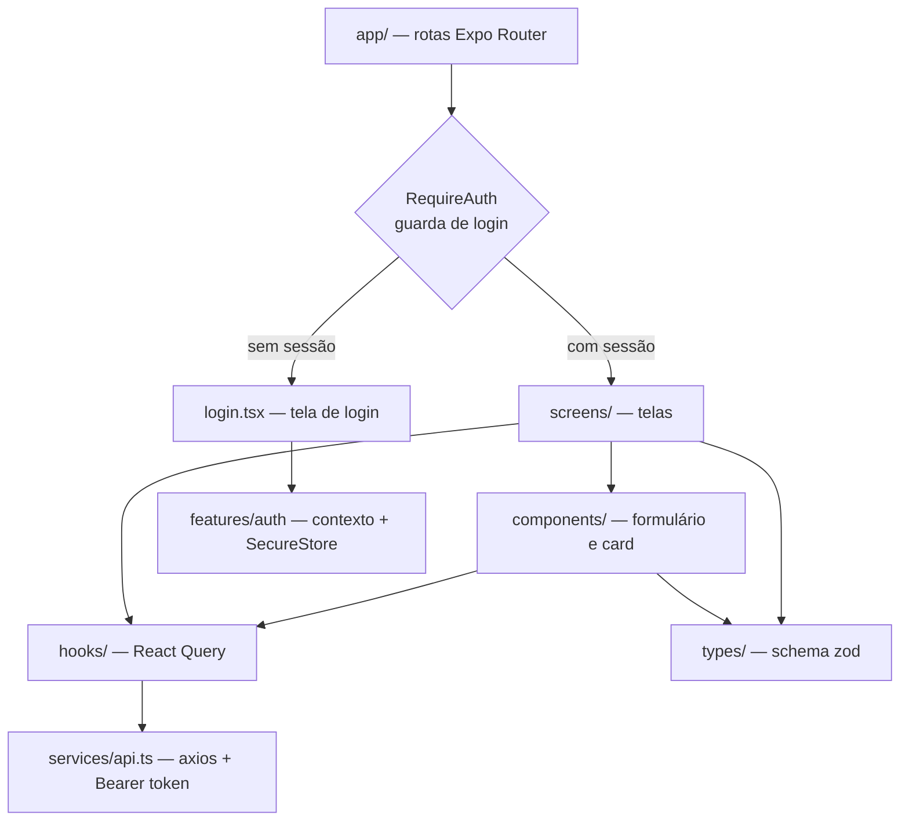
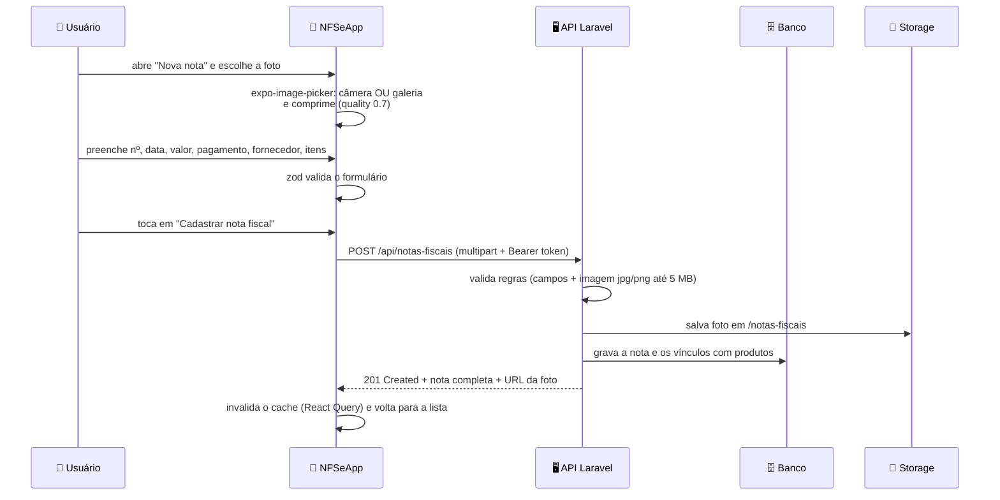
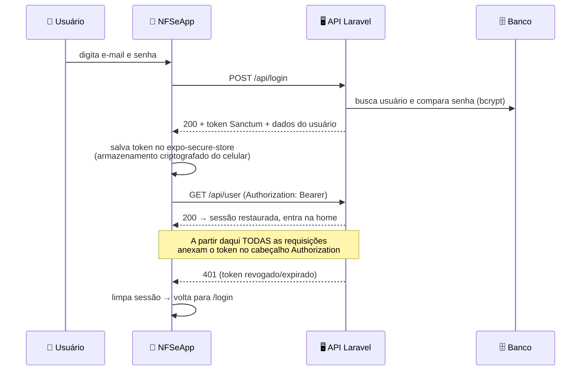
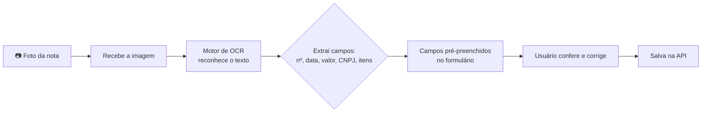

# Apresentação — NFSe Solutions

> Guia de apresentação da estrutura atual do projeto, escrito para quem **não**
> precisa dominar o código. Cada "slide" tem:
>
> - **Título** do slide
> - **O que mostrar** (diagrama ou lista)
> - **O que falar** (texto pronto, em linguagem simples)
> - **Possíveis perguntas** da bancada com respostas prontas
>
> Os diagramas usam sintaxe Mermaid (renderizam no GitHub, no VS Code com
> extensão, ou podem ser colados em [mermaid.live](https://mermaid.live) para
> virar imagem).

---

## Slide 1 — O que é o projeto

**O que falar:**

> "O NFSe Solutions é um aplicativo de celular para **gestão de notas fiscais de
> fornecedores**. Ele foi feito na disciplina de Dispositivos Móveis da FATEC
> Praia Grande e é dividido em duas partes que conversam entre si: um
> **aplicativo** que roda no celular e uma **API** (um servidor de dados) que
> roda no computador."

**Estrutura do repositório:**

```
NFSe-Solutions/
├── TPNotafiscalAPI/   → Backend: servidor de dados (Laravel/PHP)
├── NFSeApp/           → Frontend: aplicativo de celular (Expo/React Native)
└── docs/              → Documentação (apresentação e análise)
```

**Possíveis perguntas:**

- *Por que duas partes?* → Separação de responsabilidades: o celular cuida da
  interface, o servidor cuida dos dados e das regras. É o padrão da indústria.

---

## Slide 2 — Visão geral da arquitetura

**O que mostrar:** diagrama abaixo.



**O que falar:**

> "O fluxo é simples: o usuário preenche o formulário no celular e anexa a foto
> da nota. O aplicativo envia tudo para a API, que **valida os dados**, salva no
> **banco de dados** e guarda a **foto** em armazenamento. Quando o usuário
> abre a lista, a API devolve os dados e a URL da foto para exibir no card."

---

## Slide 3 — Componentes do aplicativo (frontend)

**O que mostrar:** estrutura de pastas + diagrama de dependências.

```
NFSeApp/
├── app/                        → Rotas (Expo Router) — apenas "delegam" para as telas
│   ├── _layout.tsx             → Layout raiz: React Query + AuthProvider + cabeçalho
│   ├── login.tsx               → Tela de login (autenticação)
│   ├── index.tsx               → Home (mostra a sessão ativa + sair)
│   └── notas-fiscais/
│       ├── index.tsx           → Lista (paginada, "Carregar mais")
│       ├── new.tsx             → Cadastro
│       └── [id]/edit.tsx, [id]/delete.tsx
├── features/auth/              → Autenticação (módulo completo)
│   ├── context/AuthContext.tsx     → sessão do usuário (restaura token salvo)
│   ├── components/RequireAuth.tsx  → guarda de rotas (sem login → /login)
│   ├── hooks/useLogin.ts, useLogout.ts
│   ├── screens/LoginScreen.tsx
│   └── utils/tokenStorage.ts       → token no expo-secure-store (criptografado)
├── features/notas-fiscais/     → Toda a lógica da funcionalidade
│   ├── types/NotaFiscalSchema.ts   → Contratos de dados (zod)
│   ├── hooks/                      → 7 hooks React Query (cache + chamadas)
│   ├── components/                 → NotaFiscalForm, NotaFiscalCard
│   ├── screens/                    → List, Create, Edit, Delete
│   └── utils/                      → toFormData, apiErrors (erros por campo)
├── services/api.ts             → Cliente axios (Bearer token + tratamento 401)
├── services/mediaUrl.ts        → Reconstrói URL das fotos com o IP da API
└── constants/Theme.ts          → Cores, espaçamentos, raios
```



**O que falar:**

> "Seguimos o padrão **feature**: tudo que é da nota fiscal fica dentro de
> `features/notas-fiscais`, dividido em **tipos** (o contrato dos dados),
> **hooks** (a comunicação com a API e o cache), **componentes** (o formulário
> reaproveitado entre criação e edição) e **telas**. As rotas em `app/` são finas
> — só encaminham para a tela certa. Isso deixa o código fácil de localizar e
> avaliar."

**Bibliotecas exigidas pela disciplina (todas em uso):**

| Biblioteca | Onde é usada | Papel |
|---|---|---|
| `react-hook-form` | `NotaFiscalForm.tsx` | gerencia o formulário |
| `zod` + `@hookform/resolvers` | `NotaFiscalSchema.ts` | valida e descreve os dados |
| `axios` | `services/api.ts` | faz as chamadas HTTP |
| `@tanstack/react-query` | `hooks/*.ts` | cache, loading, erro e sincronização |

---

## Slide 4 — Componentes do servidor (backend)

**O que mostrar:** estrutura + tabela de endpoints.

```
TPNotafiscalAPI/
├── routes/api.php                  → login/logout + 3 recursos REST (protegidos)
├── app/Http/Controllers/
│   ├── NotaFController.php         → CRUD da nota + foto + itens
│   ├── FornecedorController.php    → CRUD de fornecedores
│   └── ProdutoController.php       → CRUD de produtos
├── app/Models/
│   ├── NotaF.php                   → tabela notas_fiscais
│   ├── Fornecedor.php              → tabela fornecedores
│   ├── Produto.php                 → tabela produtos
│   └── User.php                    → usuário (HasApiTokens do Sanctum)
├── database/migrations/            → 8 migrações (estrutura do banco)
├── database/seeders/               → dados de exemplo + usuário de teste
├── database/factories/             → fábricas para os testes automatizados
├── tests/Feature/                  → 30 testes automatizados (PHPUnit)
└── storage/app/public/             → fotos enviadas
```

**Endpoints disponíveis:**

| Método | Rota | O que faz |
|---|---|---|
| POST | `/api/login` | autentica e devolve **token** (Sanctum) |
| POST | `/api/register` | **cria conta** e já devolve token (entra logado) |
| POST | `/api/logout` | revoga o token usado |
| GET | `/api/user` | dados do usuário autenticado |
| GET | `/api/notas-fiscais` | lista (paginação de 15 em 15) |
| POST | `/api/notas-fiscais` | cria (aceita foto em multipart) |
| GET | `/api/notas-fiscais/{id}` | detalha uma nota |
| PUT | `/api/notas-fiscais/{id}` | atualiza |
| DELETE | `/api/notas-fiscais/{id}` | exclui (e apaga a foto) |
| GET/POST/PUT/DELETE | `/api/fornecedores` | CRUD de fornecedores |
| GET/POST/PUT/DELETE | `/api/produtos` | CRUD de produtos |

> Todas as rotas de recursos exigem `Authorization: Bearer <token>` — só o
> `/login` é público.

**O que falar:**

> "O backend usa o `apiResource` do Laravel, que gera automaticamente as cinco
> operações REST, e todos os recursos ficam atrás do middleware `auth:sanctum`:
> sem token, a API responde 401. O `NotaFController` é o mais completo: ele
> valida os campos, **faz upload da foto** para o armazenamento público, salva a
> nota e **vincula os produtos** na tabela de relação. Ao editar, se chegar foto
> nova ele apaga a antiga; ao excluir, apaga a foto e desvincula os itens."

---

## Slide 5 — Modelo de dados (banco)

**O que mostrar:** diagrama ER.

```mermaid
erDiagram
    FORNECEDORES ||--o{ NOTAS_FISCAIS : "emite"
    NOTAS_FISCAIS ||--o{ NOTA_FISCAL_PRODUTOS : "contém"
    PRODUTOS ||--o{ NOTA_FISCAL_PRODUTOS : "aparece em"

    FORNECEDORES {
        id id PK
        string nome
        string cnpj UK
    }
    NOTAS_FISCAIS {
        id id PK
        fornecedor_id FK
        string numero
        date dt_emissao
        decimal valor_total
        string forma_pagamento
        text observacoes
        string imagem_nf
    }
    PRODUTOS {
        id id PK
        string nome
        decimal preco_venda
    }
    NOTA_FISCAL_PRODUTOS {
        id id PK
        nota_fiscal_id FK
        produto_id FK
        unsignedInteger quantidade
        decimal preco_compra
    }
```

**O que falar:**

> "O modelo tem **quatro tabelas**. Uma nota fiscal pertence a **um fornecedor**
> e pode ter **vários produtos** — por isso existe a tabela intermediária
> `nota_fiscal_produtos`, que guarda a **quantidade** e o **preço de compra**
> daquele item naquela nota (o `preco_venda` fica no produto, é outro
> conceito). Essa é uma relação **N para N** clássica."

---

## Slide 6 — Fluxo prático: da foto ao cadastro

**O que mostrar:** diagrama de sequência.



**Pontos técnicos que valem ser citados:**

- **`toFormData.ts`** monta o `FormData` no formato que o React Native exige
  (`uri/name/type`).
- **Upload em edição:** o PHP não lê arquivo em `PUT`, por isso usamos
  `POST + _method=PUT` (*method spoofing* nativo do Laravel).
- **Cache:** após criar/editar/excluir, o React Query invalida as chaves
  `['notas-fiscais']` para a lista se atualizar sozinha.

---

## Slide 7 — Autenticação por token (Sanctum)

**O que mostrar:** diagrama do fluxo de login.



**O que falar:**

> "Seguimos o material da aula: **Laravel Sanctum** no servidor e guarda de
> token no celular. O fluxo é: login devolve um token, o app salva esse token
> no **armazenamento seguro** do aparelho (criptografado) e o **interceptor do
> axios** anexa ele automaticamente em toda requisição. As rotas da API estão
> atrás do middleware `auth:sanctum` — **sem token, a resposta é 401**. Se o
> token for revogado, o próprio app detecta o 401, limpa a sessão e devolve o
> usuário para o login. Um `RequireAuth` nas rotas garante que ninguém acesse
> as telas internas deslogado. Dá para **criar conta** pela tela de cadastro —
> o backend valida os campos, grava a senha já **criptografada (bcrypt)** e já
> devolve o token, então o usuário novo entra no app direto. Um usuário de
> teste vem pronto no seeder."

**Possíveis perguntas:**

- *Onde o token fica guardado?* → No `expo-secure-store`, que usa o
  Keychain/Keystore do sistema operacional — é o mesmo lugar onde apps de
  banco guardam dados sensíveis. Há também uma cópia em memória só para o
  interceptor ler de forma síncrona.
- *E se o servidor perder o token?* → Basta chamar `/logout`, que revoga o
  token no banco; a próxima requisição recebe 401 e o app sai da conta
  sozinho.

---

## Slide 8 — Testes automatizados

**O que mostrar:** tabela de cobertura + comandos.

| Nível | Ferramenta | Comando | Resultado |
|---|---|---|---|
| Backend (API) | PHPUnit | `php artisan test` | ✅ **30/30** |
| Frontend (lógica) | Vitest | `npm test` | ✅ **31/31** |
| Tipos (TypeScript) | tsc | `npm run typecheck` | ✅ **0 erros** |
| Integração (API real) | script cURL | ver `docs/TESTES.md` | ✅ **17/17** |

**O que falar:**

> "São **78 verificações automatizadas**. Os testes do backend cobrem a
> autenticação (login certo/errado, **cadastro de conta nova**, bloqueio sem
> token, logout que revoga o token), o CRUD completo da nota (inclusive
> **upload de foto** e a **substituição da foto antiga** na edição) e os
> recursos auxiliares. No app, os testes cobrem a lógica pura: os schemas de
> validação (login e cadastro), a montagem do `FormData`, a correção da URL
> das fotos e o mapeamento dos erros do servidor para os campos. Tudo roda em
> **SQLite em memória**, sem afetar o banco real, e o teste de integração
> percorre o fluxo inteiro contra o servidor rodando — cadastro, login, CRUD e
> logout, 17 verificações."

**Possíveis perguntas:**

- *Por que não testam as telas?* → A lógica de UI é validada pelo checklist
  manual (está no `docs/TESTES.md`); o próximo passo é Detox para testes E2E
  em emulador — está no roadmap.
- *Como eu rodo?* → `php artisan test` no backend e `npm test` no app; os
  dois levam menos de 2 segundos juntos.

---

## Slide 9 — Qualidade e boas práticas aplicadas

**O que falar (lista de pontos para a bancada):**

- **Validação em duas camadas:** `zod` no celular (feedback imediato ao usuário)
  e `$request->validate()` no servidor (regra de verdade). Nenhum dado inválido
  chega ao banco.
- **Contratos tipados:** os schemas Zod espelham exatamente os campos do Model
  Laravel — se a API mudar um nome de campo, o app falha **alto** (erro claro)
  em vez de quebrar em silêncio.
- **Estados de UI completos:** lista trata *loading*, *erro com botão de
  tentar de novo*, *vazio* e *pull-to-refresh*; botões desabilitam durante o
  envio.
- **Autenticação real:** token Sanctum em todas as rotas da API, salvo no
  `expo-secure-store` do celular, com guarda de rotas (`RequireAuth`) e
  devolução automática ao login em caso de 401.
- **Testes automatizados:** 30 testes de feature no Laravel (PHPUnit) + 31
  testes de unidade no app (Vitest) + 17 verificações de integração contra o
  servidor real. Documentados em `docs/TESTES.md`.
- **Delete em tela própria de confirmação**, com modal — não é feito "de
  supetão" na lista.
- **Tema centralizado** (`constants/Theme.ts`): cores, espaçamentos e raios
  iguais em todas as telas.
- **Segurança de ambiente:** `EXPO_PUBLIC_API_URL` vem de `.env` e o README
  explica por que `localhost` não funciona em dispositivo físico.

---

## Slide 10 — O que ainda NÃO está pronto (honestidade técnica)

> Falar isso **antes** de perguntarem mostra domínio do projeto.

1. **Reconhecimento automático (OCR) não implementado.** Hoje a foto é apenas
   **anexada**; os campos são digitados manualmente. O reconhecimento é o
   próximo passo (ver Slide 11).
2. **API em HTTP simples** — para produção, seria necessário HTTPS + rate
   limit no login (está no roadmap).
3. **Testes de UI (E2E) ainda não criados** — a lógica está testada; as telas
   têm checklist manual. Próximo passo: Detox.
4. **Identificadores de build ausentes** (`android.package`,
   `ios.bundleIdentifier`) — necessários para gerar APK/App Store, não para a
   demonstração.

> Itens que **já foram resolvidos** nesta etapa: câmera ✅, paginação da lista
> ✅, URL das fotos no celular ✅, autenticação ✅, itens/produtos no
> formulário ✅, erros por campo ✅ e testes ✅.

---

## Slide 11 — Próximos passos: o reconhecimento da nota fiscal

**O que mostrar:** diagrama do fluxo planejado.



**Opções técnicas (escolher uma na apresentação):**

| Opção | Onde roda | Prós | Contras |
|---|---|---|---|
| **A. Google Cloud Vision** | na nuvem, chamado pela API Laravel | ótima precisão, fácil de integrar no backend | precisa chave de API / custo |
| **B. ML Kit (on-device)** | no próprio celular | grátis, offline, privacidade | exige build nativo (dev client) |
| **C. Tesseract** | servidor próprio | 100% gratuito | precisa tratar pré-processamento da imagem |

**Recomendação prática:** começar pela **Opção A** com um endpoint
`POST /api/notas-fiscais/reconhecer` que devolve os campos sugeridos, e o app
apenas **pré-preenche o formulário** — o usuário confirma antes de salvar
(*reconhecimento assistido*, mais seguro do que salvar automático).

---

## Slide 12 — Conclusão

**O que falar:**

> "Hoje o projeto tem um **CRUD completo e funcional** nas duas camadas,
> com autenticação por token e **cadastro de conta**, câmera para fotografar a
> nota, itens de produto no formulário, validação em dupla, upload de foto,
> **78 verificações automatizadas** e organização em padrão de mercado. A
> etapa seguinte é transformar essa foto em **informação**, usando OCR para
> pré-preencher o formulário — que é o objetivo final do trabalho."

---

## Perguntas prováveis da bancada (respostas prontas)

| Pergunta | Resposta |
|---|---|
| *Por que usaram Expo e não Android Studio?* | A disciplina é de Dispositivos Móveis e o Expo permite rodar em iOS e Android com um só código, além de facilitar o teste em celular real via QR code. |
| *Por que React Query se o axios já busca os dados?* | O axios transporta; o React Query guarda em cache, evita buscas repetidas, controla *loading/erro* e sincroniza a lista após criar, editar ou excluir. |
| *Onde a foto fica guardada?* | Em `storage/app/public/notas-fiscais/`, servida pela API pela URL `imagem_nf_url` (reconstruída no app com o IP da máquina). |
| *Como a validação funciona?* | Duas camadas: `zod` no app (UX) e `$request->validate()` no Laravel (segurança). Erros do servidor aparecem campo a campo no formulário. |
| *Por que tiveram que usar `POST + _method=PUT`?* | Porque o PHP não processa `multipart/form-data` em requisições `PUT`; o Laravel resolve com *method spoofing*. |
| *O app está protegido?* | Sim: login com token Sanctum (material da aula), token guardado no armazenamento seguro do celular, todas as rotas da API exigem `Authorization: Bearer` e o 401 devolve o usuário para o login. |
| *Como vocês sabem que funciona?* | 78 verificações automatizadas: 30 testes no backend, 31 no app, 17 de integração contra o servidor real + checklist manual das telas (`docs/TESTES.md`). |
| *Dá para criar conta nova?* | Sim: tela "Criar conta" → `POST /api/register` valida os campos, grava a senha criptografada (bcrypt) e já devolve o token — o usuário entra logado na hora. E-mail duplicado é recusado. |
| *O reconhecimento já funciona?* | Ainda não: hoje a foto é anexada (câmera ou galeria) e os campos digitados. O OCR é o próximo módulo, com opções já mapeadas (Slide 11). |
| *Dá para rodar o projeto?* | Sim: backend com `composer install` + `php artisan migrate --seed` + `php artisan serve`; app com `npm install` e `npx expo start` apontando `EXPO_PUBLIC_API_URL` para o IP da máquina. Login: `test@example.com` / `password`. |
